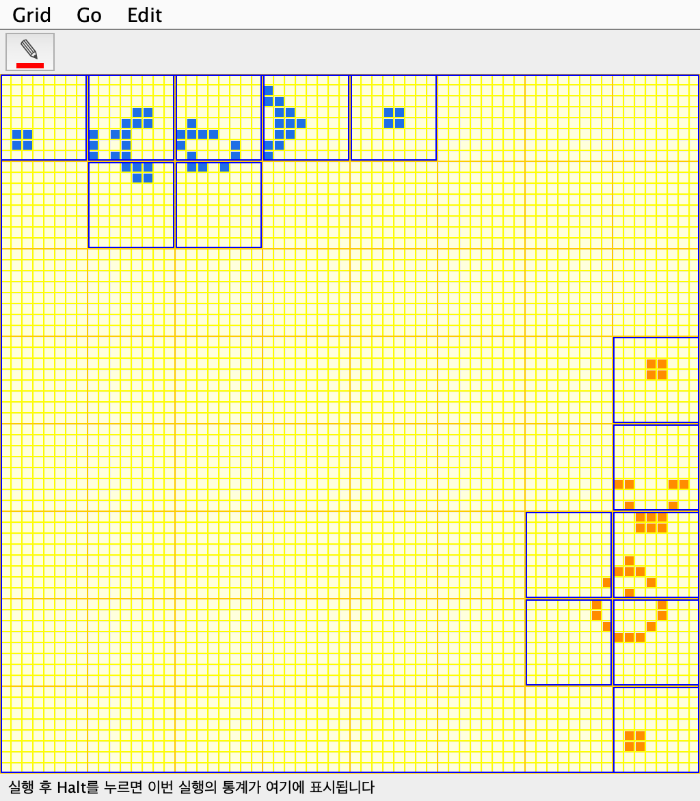

<div align="center">



# DP_Term_Project_02

*Refactoring Holub's Game of Life with design patterns.*

Allen Holub의 HolubLife 1.02(Conway의 Game of Life, Java Swing)를<br />
설계 패턴으로 리팩터링하고 기능을 확장했다.


**2026 중앙대학교 설계패턴** · 01분반 02조 · 김태우 · 박신빈 · 안재인

</div>

## 폴더 구조

```
src/com/holub/
├── life/              게임 모델과 화면
│   ├── command/       메뉴 Command (Go, Grid, Edit)
│   ├── mouse/         마우스 모드 (칠하기, 스탬프)
│   ├── painter/       Swing 셀 그리기
│   └── brush/         펜 색 툴바
└── ui, tools, io, asynch/   원본 라이브러리

test/
├── unit/              단위 테스트
├── integration/       통합 테스트 (original/: 원본 결함 재현)
├── support/           드라이버, 테스트 더블, 원본 코드 사본
└── resources/         테스트용 패턴 파일
```

| 주요 클래스 | 역할 |
|---|---|
| `Life` | `main`이 있다. 모든 객체를 만들어 연결한다 |
| `Board` | 게임 모델. 셀 트리(`Neighborhood`, `Resident`)를 만들고 세대 진행, 클릭, Clear, Load/Store를 맡는다. Swing을 모른다 |
| `LifeGame` | `Board`와 시계(`TickSource`)를 묶는 Facade. 메뉴와 화면은 이 클래스로만 게임을 바꾼다 |
| `Universe` | 보드를 그리고 마우스 픽셀 좌표를 셀 좌표로 바꾸는 `JPanel` |
| `Clock` | 일정 간격으로 tick을 낸다. 실제 타이머는 `TickTimer`로 받는다 |

## 지원하는 파일 형식

Grid → Load / Store / Stamp의 파일 창에서 고를 수 있는 확장자다.

| 확장자 | 형식 | Load | Store | Stamp | 셀 색 | 패턴 위치 |
|---|---|---|---|---|---|---|
| `.life` | 원본과 같은 Java 직렬화 좌표 목록. 뒤에 색 표를 붙인다 | O | O | X | 저장한다. 색이 없는 예전 파일은 기본색(빨강)으로 연다 | 저장한 좌표 그대로 |
| `.rle` | 다른 Game of Life 프로그램에서 쓰는 RLE 텍스트 | O | O | O | 저장하지 않는다 (읽으면 기본색) | `#R`에 쓴다. Load할 때 `#R`이 없으면 가운데에 놓는다. Stamp는 `#R`을 무시하고 클릭한 곳에 찍는다 |

- 다른 확장자를 고르면 오류 창이 뜨고 보드는 그대로다.
- 규칙이 B3/S23이 아니거나 보드에 놓을 수 없는 `.rle`도 오류 창을 띄우고 보드를 그대로 둔다.
- 형식 목록은 `Life.main`에서 `PatternFormats`에 넣는다. 새 형식은 `PatternFormat`을 구현해 이 목록에 더하면 된다.

## 실행 방법

JDK 17 이상이 필요하다. 빌드 도구는 쓰지 않는다. 모든 명령은 저장소 루트에서 실행한다.

```bash
javac -encoding UTF-8 -d out/main $(find src -name '*.java')
java -cp out/main com.holub.life.Life
```

## 테스트 방법

테스트는 JUnit 5로 작성했다. 실행하려면 JUnit 5가 설치되어 있어야 한다.

`src`를 위처럼 `out/main`에 컴파일한 뒤, 테스트를 컴파일하고 아래 표의 옵션을 붙여 실행한다.

```bash
JUNIT=junit-platform-console-standalone-1.11.4.jar
javac -encoding UTF-8 -cp out/main:$JUNIT -d out/test $(find test -name '*.java')
java -jar $JUNIT execute --class-path out/main:out/test --scan-class-path <옵션>
```

| 실행 | `<옵션>` | 결과 |
|---|---|---|
| 전체 | `--exclude-tag known-defect` | 446개 모두 통과 |
| 기존 기능 | `--include-tag original` | 108개 모두 통과 |
| 기능 확장 | `--include-tag extension` | 296개 모두 통과 |
| 설계 개선 | `--include-tag improvement` | 42개 모두 통과 |
| 원본 결함 | `--include-tag known-defect` | 13개 모두 실패 (원본 사본의 결함 재현, 정상) |
| 단위 테스트 | `test/unit`, `test/support`만 `out/unit`에 컴파일하고 `--class-path out/main:out/unit`으로 실행 | 194개 모두 통과 |

테스트가 `test/resources/...`를 상대 경로로 열기 때문에 저장소 루트에서 실행해야 한다. Windows에서는 클래스패스 구분자 `:`를 `;`로 바꾼다.
